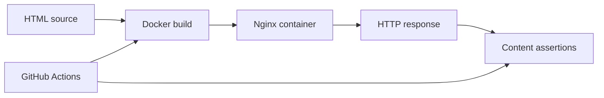

# DevOps Deployment Lab

A small containerised static website used to practise Docker image builds, Nginx-based delivery, versioned application changes, and automated verification with GitHub Actions.

## Project status

The repository contains a simple HTML page, a Dockerfile based on the Nginx stable image, and a GitHub Actions workflow. The workflow builds the image, starts a test container, requests the page over HTTP, and checks for expected page content.

This is a focused beginner-to-intermediate deployment exercise, not a production application or cloud deployment.

## Architecture



## Technology stack

- HTML
- Docker
- Nginx
- GitHub Actions
- Linux command-line tools
- curl and shell assertions

## Repository structure

```text
devops-deployment-lab/
├── .github/
│   └── workflows/
│       └── ci.yml
├── Dockerfile
├── index.html
└── README.md
```

## Run locally

Build the image:

```bash
docker build -t kelvin-web:local .
```

Start the container:

```bash
docker run --rm -d --name kelvin-web -p 8080:80 kelvin-web:local
```

Verify the page:

```bash
curl --fail http://127.0.0.1:8080
```

The response should contain the page heading and version string from `index.html`.

Stop the container:

```bash
docker stop kelvin-web
```

## CI workflow

The GitHub Actions workflow runs on pushes and pull requests targeting `main`. It:

1. Checks out the repository without persisting the checkout token.
2. Builds the Docker image.
3. Starts a temporary container bound to localhost.
4. Uses curl to verify the HTTP response.
5. Checks for the expected page title and version.
6. Prints container logs and removes the test container, including on failure.

The workflow validates that the image can be built and that the served page contains expected content. It does not publish an image or deploy to a cloud environment.

## What this demonstrates

- Writing a minimal Dockerfile for a static web workload.
- Serving static content with Nginx.
- Building containers in a CI environment.
- Testing a running container through its HTTP interface.
- Adding simple content assertions to a pipeline.
- Cleaning up test resources after CI execution.

## Possible next steps

- Add an Nginx health check.
- Add a non-root runtime configuration where practical.
- Add an image vulnerability scan.
- Publish immutable image tags to a container registry.
- Add a deployment stage only after defining and testing a target environment.

## Author

**Kelvin Arigbe**  
[GitHub profile](https://github.com/KelvinArigbe)
